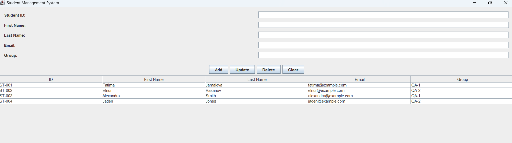

# Student Management System

A desktop application developed as Task 1 of the Auspify Technologies
Software Development Internship.

Built with Java 21 and Swing, the application allows users to manage
student records through a graphical interface.

## Features

- Add and view student records.
- Update student details while keeping the student ID unchanged.
- Delete records with confirmation.
- Validate required fields and email format.
- Prevent duplicate student IDs (case-insensitive).
- Save records locally and reload them when the application starts.

## Technologies

- Java 21
- Java Swing
- Java file I/O
- Git and GitHub

## Project Structure

- `src/Student.java` — student data model.
- `src/StudentRepository.java` — local file storage.
- `src/StudentManagementApp.java` — interface and application entry point.

## Run in IntelliJ IDEA

1. Open the repository in IntelliJ IDEA.
2. Configure JDK 21.
3. Mark this task's `src` folder as Sources Root if necessary.
4. Run `StudentManagementApp.main()`.
5. Set the run configuration's working directory to
   `$PROJECT_DIR$/task-01-student-management`
   when the repository root is the IntelliJ project directory.

## Run from the Terminal

With JDK 21 installed, open a terminal in this task's folder:

```shell
javac -encoding UTF-8 -d out src/Student.java src/StudentRepository.java src/StudentManagementApp.java
java -cp out StudentManagementApp
```

## Data Storage

Records are saved in `data/students.dat`, relative to the working directory.
The file is created automatically when records are saved.

Local data and compiled files are excluded from version control.
This application uses file storage rather than a database.

## Manual Verification

The following checks were completed during development:

- Add a student and verify the record in the table.
- Restart the application and verify saved records.
- Update student information.
- Reject empty required fields.
- Reject duplicate student IDs.
- Reject an invalid email format.
- Cancel and confirm deletion.
- Restart the application and verify deleted records remain removed.


## Screenshot




## Author

Fatima Jamalova