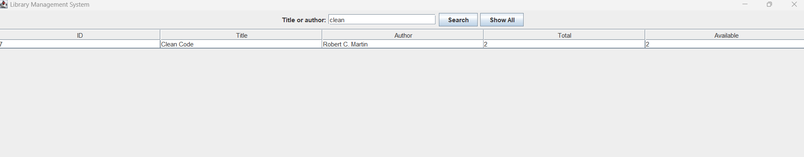
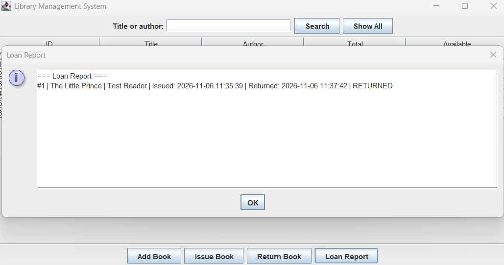

# Task 2 — Library Management System

A Java 21 desktop application built with Swing and SQLite for the
Auspify Technologies Software Development Internship.

## Features

- Add books and track total and available copies.
- Search books by title or author.
- Issue a book to a reader and return it using the loan ID.
- View loan history with issue dates, return dates, and loan status.

## Run in IntelliJ IDEA

1. Import `pom.xml` as a Maven project and select JDK 21.
2. Run `LibraryManagementApp` using the `library-management` module.
3. Set the run configuration's working directory to this task folder.
   The application creates `library.db` there on first run.

## Screenshots

### Book Search

### Loan Report

## Author

Fatimə Tahirova