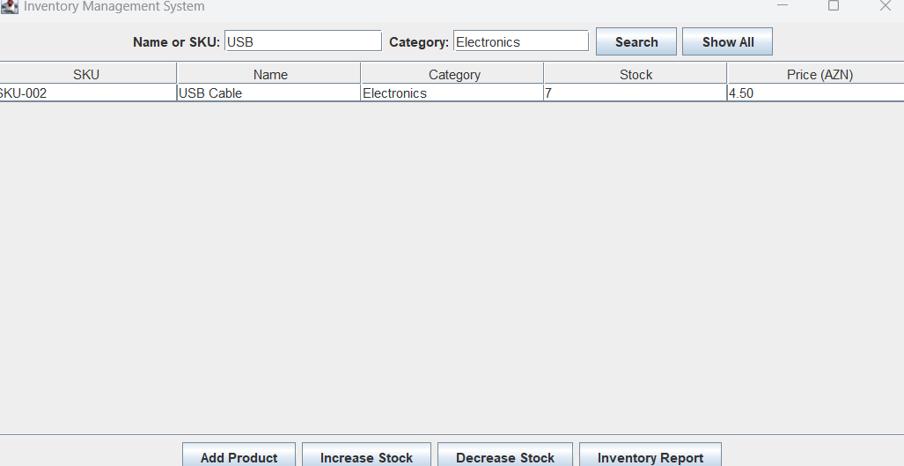
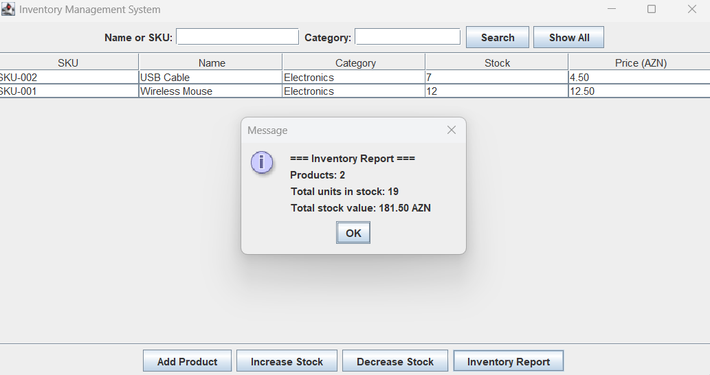

# Task 3 — Inventory Management System

A desktop inventory application built with Java 21, Swing, and SQLite
for the Auspify Technologies Software Development Internship.

## Features

- Register products with a unique SKU, category, stock quantity, and unit price.
- Increase or decrease stock without allowing negative quantities.
- Search by product name or SKU and filter by category.
- View an inventory report showing product count, total units, and stock value.

## Run in IntelliJ IDEA

1. Import `pom.xml` as a Maven project and select JDK 21.
2. Run `InventoryManagementApp` using the `inventory-management` module.
3. Set the working directory to `task-03-inventory-management`.
   The application creates `inventory.db` there if it does not exist.

## Screenshots

### Product Search

### Inventory Report

## Author

Fatimə Tahirova