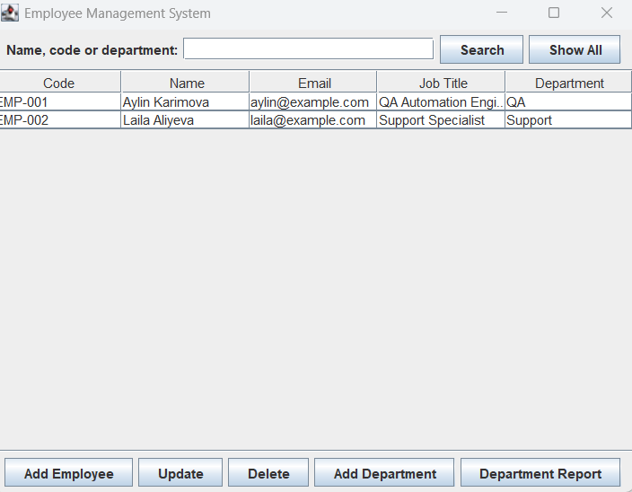
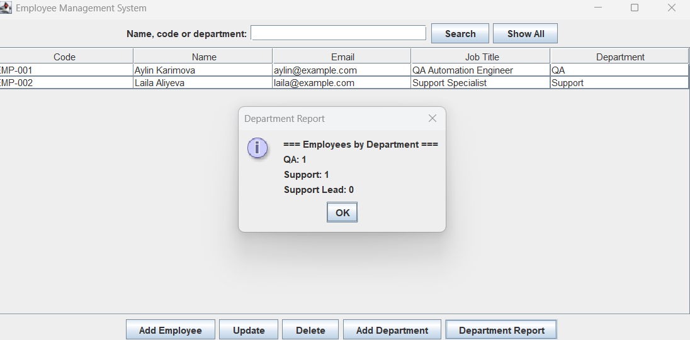

# Task 4 — Employee Management System

A desktop application built with Java 21, Swing, and SQLite for the
Auspify Technologies Software Development Internship.

## Features

- Register, update, and delete employee records.
- Assign employees to departments and add new departments.
- Search employees by name, employee code, or department.
- View employee counts by department, including departments with no employees.

## Run in IntelliJ IDEA

1. Import `pom.xml` as a Maven project and select JDK 21.
2. Run `EmployeeManagementApp` using the `employee-management` module.
3. Set the working directory to `task-04-employee-management`.
   The application creates `employees.db` there on first run.

## Screenshots

## Author

Fatimə Tahirova